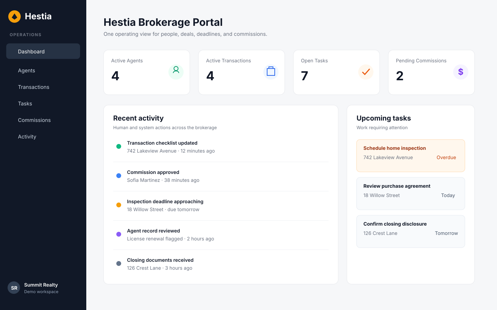
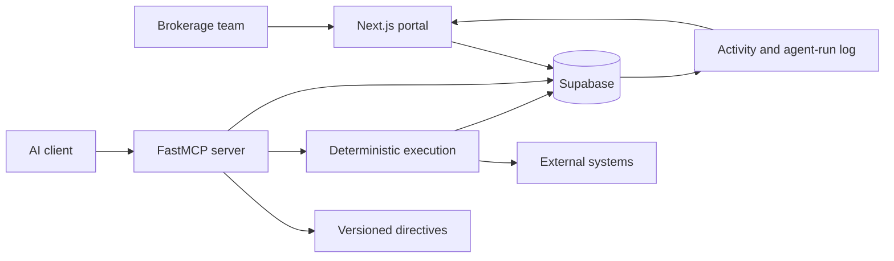

# Hestia

**An AI operations system that turns a company's data and standard operating procedures into controlled, auditable work.**

[Live brokerage prototype](https://portal.hestiaops.com) · [Architecture](#architecture) · [Run locally](#run-locally)

Hestia is an early-stage operating layer for service businesses. Instead of adding another disconnected chatbot, it gives humans and AI agents the same structured context: customers, projects, transactions, tasks, documents, directives, and a complete activity trail.

The current hosted prototype focuses on real-estate brokerage operations. It connects agents, transactions, deadlines, task checklists, commissions, and activity in one workspace. The repository also contains the broader agent architecture: versioned SOP directives, an MCP orchestration server, deterministic execution scripts, and reusable business templates.

> **Project status:** working prototype. The portal and core records are functional; the end-to-end autonomous transaction coordinator described in the vision is not yet complete. The capability table below deliberately separates shipped functionality from the next build stage.

## Why Hestia

Important operational work is usually split across a CRM, spreadsheets, inboxes, document tools, and employees' memory. That fragmentation makes conventional AI assistants unreliable: they can answer questions, but they do not have a durable model of the business or a safe way to execute its procedures.

Hestia approaches the problem as an operating system:

1. **Structured operational context** in Postgres rather than an unbounded chat history.
2. **Directives as versioned SOPs** that describe goals, constraints, edge cases, and expected outputs.
3. **Agent orchestration through MCP** so an AI client can inspect and modify approved business records.
4. **Deterministic execution code** for actions that should not depend on model improvisation.
5. **An immutable activity trail** so every human and agent action can be reviewed.

## Working demo

The live deployment runs Hestia in brokerage mode:

**[Open portal.hestiaops.com](https://portal.hestiaops.com)**

The demo is authenticated because it exposes write-capable workflows. Demo access can be supplied separately to reviewers.



<sub>Static interface preview based on the repository's fictional Summit Realty demo dataset.</sub>

### Implemented now

| Area | What works |
| --- | --- |
| Identity and access | Supabase authentication, workspace membership, admin/team/client/agent roles, protected routes |
| Brokerage operations | Agent directory, transaction pipeline, transaction detail, properties and closing dates |
| Work management | Tasks, priorities, due dates, assignments, status changes, transaction checklists |
| Financial operations | Commission records, pending/approved/paid/disputed states, aggregate totals |
| Operational visibility | Brokerage dashboard, upcoming work, recent activity, exception-oriented counts |
| Auditability | Activity log tied to workspace records and user actions |
| Deployment | Next.js production build on Vercel with Supabase persistence and additive SQL migrations |
| Demo safety | Fictional brokerage, agents, addresses, phone numbers, and transactions |

### Built in the repository, but not fully productized

- FastMCP server with workspace, CRUD, integration, and directive tools
- Prompt resources for daily briefings, status reports, client onboarding, meeting processing, and SOP execution
- Markdown directives with YAML metadata
- Deterministic Python execution layer for repeatable operations
- Configurable templates for brokerages, agencies, professional services, and Hestia itself
- Generic team, client, document, project, lead, campaign, and application surfaces
- Agent-run API primitives and execution status records

### Next product milestone

The next milestone is one complete **transaction-coordinator loop**:

`new transaction → generate checklist → detect missing/late requirement → assign follow-up → record outcome → update commission and audit trail`

That loop—not another collection of CRM screens—is the central product wedge.

## Architecture



### Three-layer agent model

| Layer | Responsibility | Location |
| --- | --- | --- |
| Directives | Human-readable SOPs, constraints, and success criteria | `directives/` |
| Orchestration | MCP tools and prompts that select context and coordinate work | `mcp-server/` |
| Execution | Deterministic Python operations and integration adapters | `execution/` |

The portal is the human control plane. Supabase is the system of record. Agent actions use the same underlying records and are intended to leave the same auditable trail as human actions.

## Repository map

```text
.
├── portal/       Next.js 16 portal and server actions
├── brokerage/    Brokerage schema, security policies, and fictional demo seed
├── supabase/     Generic Hestia schema and migrations
├── mcp-server/   FastMCP tools, prompts, and resources
├── directives/   Version-controlled operating procedures
├── execution/    Deterministic Python operations
├── templates/    Per-business terminology and workflow configuration
├── scripts/      Bootstrap and demo-seeding utilities
└── docs/         Setup, deployment, MCP, and demo documentation
```

## Technology

- **Application:** Next.js 16, React 19, TypeScript, Tailwind CSS
- **Data and auth:** Supabase Postgres, Auth, Storage, Row Level Security
- **Agent interface:** Python, FastMCP
- **Validation and UI:** Zod, React Hook Form, Radix UI
- **Hosting and CI:** Vercel, GitHub Actions

## Run locally

### 1. Configure Supabase

Create a Supabase project, then copy the example environment file:

```bash
cp .env.example .env
```

Fill in your own values. Never commit `.env` or `portal/.env.local`.

For the brokerage prototype, apply the migrations in order:

```text
brokerage/migrations/001_initial_brokerage_schema.sql
brokerage/migrations/002_security_hardening.sql
brokerage/migrations/003_hestia_compatibility.sql
brokerage/migrations/004_hwa_demo_seed.sql
```

The final migration contains only fictional demonstration data.

### 2. Start the portal

```bash
cd portal
npm install
cp ../.env.example .env.local
```

Add the following mode settings to `portal/.env.local`:

```dotenv
NEXT_PUBLIC_PORTAL_MODE=brokerage
NEXT_PUBLIC_SIGNUP_ENABLED=false
```

Then run:

```bash
npm run dev
```

Open `http://localhost:3000`.

### 3. Run the MCP server

```bash
cd mcp-server
python -m venv .venv
source .venv/bin/activate
pip install -r requirements.txt
python server.py
```

See [`docs/CLAUDE_MCP_SETUP.md`](docs/CLAUDE_MCP_SETUP.md) and [`docs/MCP_TOOLS_REFERENCE.md`](docs/MCP_TOOLS_REFERENCE.md) for client configuration and the exposed tool surface.

## Verification

```bash
cd portal
npm ci
npm run lint
npm run build

cd ..
python -m compileall -q execution mcp-server scripts
```

The current production snapshot builds successfully. ESLint reports no errors; a small number of unused-variable warnings remain in inherited generic portal screens.

## Security and data handling

- Environment files and Vercel metadata are ignored.
- Service-role credentials are server-only and must never use a `NEXT_PUBLIC_` prefix.
- Public signup is disabled in the production demo.
- Database migrations add Row Level Security policies and workspace-scoped access.
- Demo records are fictional and use reserved example-style contact information.
- This public repository is a clean snapshot and does not include the private development repository's Git history.

If you deploy Hestia yourself, use a fresh Supabase project and rotate any credential that has ever appeared in a terminal transcript, screenshot, or chat.

## Honest roadmap

1. Complete the transaction-coordinator loop and expose agent-run state in the portal.
2. Add document ingestion, deadline extraction, and compliance exceptions.
3. Add approval gates for consequential writes and outbound communication.
4. Connect email, calendar, document storage, and transaction-management systems.
5. Add scenario-based evaluation for SOP completion, safety, and audit quality.

## Documentation

- [`docs/HESTIA_PORTAL_FUNCTIONALITY_MAP.md`](docs/HESTIA_PORTAL_FUNCTIONALITY_MAP.md) — route and capability map
- [`docs/HWA_DEMO_RUNBOOK.md`](docs/HWA_DEMO_RUNBOOK.md) — concise demo narrative
- [`docs/SETUP_GUIDE.md`](docs/SETUP_GUIDE.md) — full environment setup
- [`brokerage/README.md`](brokerage/README.md) — brokerage schema and deployment notes

---

Hestia is being built around a simple premise: an AI operations system should be useful because it understands the business, safe because it follows explicit procedures, and trustworthy because every action is inspectable.
